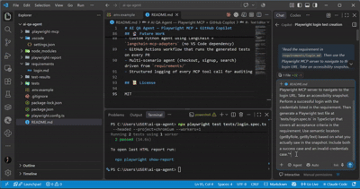
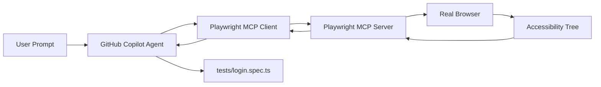

# AI QA Agent — Playwright MCP + GitHub Copilot

[](https://github.com/Trushiii/Ai-QA-Agent/actions/workflows/playwright.yml)

...

An AI-powered QA agent that reads natural-language requirements, explores a live web application using the Playwright MCP server, and generates working Playwright tests based on what it actually sees on the page.



## 🎯 What It Does

Instead of writing test selectors by hand, this project uses the **Playwright Model Context Protocol (MCP) server** to give an AI agent real browser control. The agent:

1. Reads a requirement from `requirements/`
2. Navigates to the target URL and takes an **accessibility snapshot**
3. Identifies elements by their **role, name, and ref** (not guessed CSS selectors)
4. Generates a Playwright test in TypeScript that reflects the real page structure
5. Runs it — passing tests mean the AI's mental model matched reality

## 🏗 Architecture



The agent communicates with the browser via the **Model Context Protocol** — an open standard that exposes browser actions (navigate, click, type, snapshot) as structured tools the LLM can call.

## 📂 Project Structure

```
.
├── .vscode/settings.json    # MCP server config with origin allowlist
├── requirements/login.md    # Natural-language acceptance criteria
├── tests/login.spec.ts      # AI-generated Playwright test
├── playwright.config.ts
└── README.md
```

## 🚀 Setup

### Prerequisites
- Node.js 18+
- VS Code with GitHub Copilot (Agent Mode enabled)
- Playwright MCP server

### Install

```bash
npm install
npx playwright install
```

### Configure MCP

The MCP server is configured in `.vscode/settings.json` with an **origin allowlist** — a safety guardrail that restricts the browser to approved domains only.

### Run the tests

```bash
npx playwright test --project=chromium --workers=1 --headed
```

## 🔐 Safety Considerations

This project treats the AI agent as **untrusted by default**:

| Control | Implementation |
|---|---|
| Origin allowlist | `--allowed-origins` flag in MCP config |
| No auto-approval | Every MCP tool call requires manual confirmation |
| No secrets in prompts | Credentials stored in `.env`, never sent to the LLM |
| Isolated project config | MCP settings live in `.vscode/`, not global |

**Note:** Playwright MCP is not a security boundary on its own. These are guardrails to reduce risk in a demo/portfolio context.

## 🧠 Lessons Learned

- **Parallelism ≠ always faster.** Running 3 browsers × 4 workers on a laptop caused browser processes to be killed mid-navigation (`Target page has been closed`). Running `--project=chromium --workers=1` was reliably green.
- **Third-party demo sites are flaky.** `the-internet.herokuapp.com` occasionally resets connections. Real projects should use owned staging environments.
- **Accessibility-tree-based automation is deterministic.** Unlike screenshot-based agents, this approach doesn't need vision models and produces stable, semantic locators (`getByRole('button', { name: 'Login' })`).

## 🔮 Future Work

- Custom Python agent using LangChain + `langchain-mcp-adapters` (no VS Code dependency)
- GitHub Actions workflow that runs the generated tests on every PR
- Multi-scenario agent (checkout, signup, search) driven from `requirements/`
- Structured logging of every MCP tool call for auditing

## 📜 License

MIT